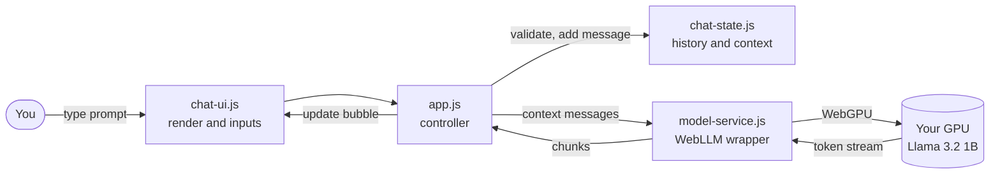

<div align="center">

# 📱 PocketLLM

**A private AI chatbot that lives in your browser tab.**
No server. No API key. No sign-up. Your messages never leave your device.

[](LICENSE)
[](https://webgpu.github.io/webgpu-samples/)
[](https://webllm.mlc.ai/)
[](#-tech-stack)
[](#-quick-start)

[**Live demo**](https://YOUR_USERNAME.github.io/pocketllm/) · [Quick start](#-quick-start) · [How it works](#-how-it-works) · [Troubleshooting](#-troubleshooting)

</div>


<!-- Add a screenshot or GIF here once you have one:

-->

---

## ✨ What is PocketLLM?

PocketLLM is a chat web app that downloads a small open-source language model into your browser and runs it on **your own GPU** using [WebLLM](https://webllm.mlc.ai/) and WebGPU. You type, the model answers, and the conversation stays on your device.

It's built as a learning project: a clean, dependency-free example of local inference, streaming UI, async JavaScript, error handling and separation of concerns, with no framework and no build step.

## 🎯 Features

| | |
|---|---|
| 🔒 **Private by design** | Chat text is processed on-device. There is no backend and no inference server. |
| 💸 **Free to run** | No paid API or key. You only need bandwidth for the first model download. |
| ⚡ **Streaming replies** | Text appears word by word as the model generates it. |
| 📊 **Live loading progress** | See download and compile progress; the model is cached for next time. |
| 🛑 **Stop and clear** | Interrupt a long answer any time, or wipe the conversation in one click. |
| 🧯 **Friendly errors** | Missing WebGPU, out-of-memory and generation failures show a clear message and a Retry button. |
| 🧱 **Clean architecture** | UI, chat state and model logic are separate modules. |
| 🌗 **Light and dark themes** | Follows your system setting, responsive down to phone size. |
| ♿ **Accessible basics** | Keyboard-friendly, visible focus, live status updates, reduced-motion support. |

## 🧠 How it works



1. **Start-up.** `app.js` asks `model-service.js` to initialise. It checks for WebGPU, confirms the chosen model is in WebLLM's list, then downloads (first run only) and compiles the model, reporting progress to the UI.
2. **Ready.** The status light turns green and the input unlocks.
3. **Send.** The controller rejects empty or duplicate submissions, stores your message, and sends the system prompt plus the last 12 messages to the model.
4. **Stream.** Tokens arrive as an async stream and are written into the assistant bubble.
5. **Finish or fail.** Controls are restored either way. Errors appear in the page and you can try again.

## 🚀 Quick start

PocketLLM is plain HTML, CSS and JavaScript, so there is nothing to install or build. It only needs to be served over **http://localhost** or **https** (ES modules and WebGPU don't work from `file://`).

```bash
git clone https://Hashim-stack/PocketLLM/.git
cd pocketllm
VS Code "Live Server" extension
```

Open <http://localhost:8000> in a recent desktop **Chrome or Edge**, wait for the light to turn green, and say hello.

> **First run:** the model downloads once (roughly 0.7–0.9 GB) and is cached by your browser. Later visits load much faster.

## 🌍 Deploy it (free hosting)

Because PocketLLM is fully static and GitHub Pages serves over HTTPS, it can be hosted for free. The model still runs on each visitor's own device, so you pay nothing for compute.

This repo includes a ready workflow at `.github/workflows/pages.yml`:

1. Push the repo to GitHub.
2. Go to **Settings → Pages**.
3. Under **Build and deployment → Source**, choose **GitHub Actions**.
4. Push to `main` (or run the workflow manually). Your site appears at `https://YOUR_USERNAME.github.io/pocketllm/`.

Any other static host (Netlify, Cloudflare Pages, Vercel static) works too. Just serve the repo root over HTTPS.

## 📁 Project structure

```
pocketllm/
├── index.html              Page markup and font links
├── styles.css              Theme (design tokens at the top)
├── src/
│   ├── app.js              Controller: validation, flow, error handling
│   ├── chat-ui.js          DOM rendering only
│   ├── chat-state.js       Conversation data and context trimming
│   └── model-service.js    WebLLM init, streaming, stop
├── .github/workflows/
│   └── pages.yml           Deploy to GitHub Pages
├── CONTRIBUTING.md
├── LICENSE
└── README.md
```

## ⚙️ Configuration

| What | Where | Default |
|---|---|---|
| Model | `MODEL_ID` in `src/model-service.js` | `Llama-3.2-1B-Instruct-q4f16_1-MLC` |
| WebLLM version | import URL in `src/model-service.js` | pinned `@mlc-ai/web-llm@0.2.79` |
| System prompt | `SYSTEM_PROMPT` in `src/chat-state.js` | short, helpful, concise |
| Memory length | `MAX_CONTEXT_MESSAGES` in `src/chat-state.js` | last 12 messages |
| Creativity | `temperature` in `src/model-service.js` | `0.7` |
| Colors and fonts | `:root` in `styles.css` | cobalt device theme |

**Trying another model:** pick an ID from [WebLLM's supported list](https://webllm.mlc.ai/), paste it into `MODEL_ID`, and check its size, memory needs and license first. Bigger models answer better but need more GPU memory and a longer first download. The app verifies the ID exists and tells you if it doesn't.

**Updating WebLLM:** bump the version in the import URL and test; model IDs can change between releases.

## 💻 Requirements

- **Browser:** a current desktop Chromium browser (Chrome or Edge) is the safest choice. WebGPU support in other browsers varies, so check current compatibility.
- **GPU and memory:** the default model reports needing roughly 0.9 GB of GPU memory, so it targets modest hardware. Larger models need much more.
- **Network:** needed for the first load (library, model weights, fonts). After caching it may work offline, but verify this before relying on it.

## 🔐 Privacy

- ✅ Your prompts and the model's answers are processed **in your browser** and are not sent to any server operated by this project.
- ✅ Nothing is saved. History lives in page memory and disappears when you reload or click **Clear chat**.
- ⚠️ "Local" does not mean "zero network". The browser still contacts external hosts to fetch:
  - the WebLLM library (**jsDelivr**),
  - the model weights (**Hugging Face**),
  - the page fonts (**Google Fonts**, optional: delete the three font `<link>` tags in `index.html` to avoid it).
- 🔎 Need strict offline behaviour? Open DevTools → Network and confirm what's requested after the first cached load.
- 📄 Check the license and model card of whichever model you choose.

## 🩺 Troubleshooting

| Problem | Likely cause and fix |
|---|---|
| "WebGPU isn't available" | Use a recent desktop Chrome or Edge. Make sure the page is served from `localhost` or `https`, not `file://`. |
| "No compatible GPU adapter found" | Update your GPU drivers and browser, or try another device. |
| Model "is not in WebLLM's supported list" | Your `MODEL_ID` is outdated or mistyped. Choose a current one from the WebLLM site. |
| Loading is very slow | It's the first-time download. Later loads use the browser cache. |
| Crashes or errors on a low-memory device | Close other tabs, or switch to a smaller model. |
| Blank page, console shows a module error | You opened `index.html` directly. Serve it with a local server instead. |
| Answers are wrong or odd | Small models hallucinate. Treat output as a draft, not a fact source. |

## ✅ Acceptance checklist

- [ ] A prompt returns a real model response on a supported device
- [ ] Empty input never triggers inference
- [ ] Loading and generating states are visible
- [ ] A failed model load shows an error and a working Retry, not a dead page
- [ ] **Clear chat** removes all visible messages
- [ ] README explains downloads, device needs and privacy

## 🗺️ Roadmap

- [x] Streaming responses
- [x] Stop generation
- [x] Light and dark themes
- [ ] Regenerate last answer
- [ ] Markdown and code-block rendering
- [ ] Named conversations
- [ ] Optional, opt-in local saving (IndexedDB)
- [ ] Export and import chats
- [ ] Model picker in the UI
- [ ] Settings panel (temperature, system prompt)
- [ ] Installable PWA

## ⚠️ Limitations

Small on-device models are far less capable than large hosted ones. Expect shorter reasoning, occasional mistakes and invented facts. Speed depends heavily on your GPU. This project is for learning and prototyping, not for medical, legal or financial advice.

## 🧰 Tech stack

HTML5 · CSS (custom properties, no framework) · JavaScript ES modules · [WebLLM](https://github.com/mlc-ai/web-llm) · WebGPU · GitHub Pages

## 🤝 Contributing

Ideas and pull requests are welcome. See [CONTRIBUTING.md](CONTRIBUTING.md).

## 📜 License

[MIT](LICENSE) for this project's code. WebLLM and each model have their own licenses; check them before redistributing or using commercially.

## 🙏 Acknowledgements

- [WebLLM / MLC AI](https://webllm.mlc.ai/) for in-browser inference
- [WebGPU samples](https://webgpu.github.io/webgpu-samples/) and [MDN](https://developer.mozilla.org/en-US/docs/Web/JavaScript) for learning resources
